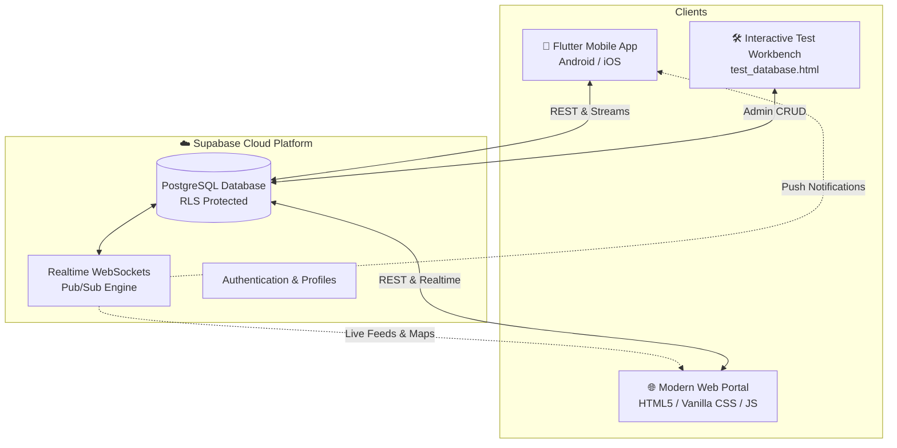

# 🌿 FoodBridge — Surplus Food Rescue & Redistribution Network

<p align="center">
  <strong>Connecting Food Kitchens with Shelters & Volunteer Couriers</strong><br>
  <em>A unified real-time humanitarian logistics platform built with Flutter, Modern Web & Supabase Cloud PostgreSQL.</em>
</p>

<p align="center">
  <a href="https://foodbridge-lemon.vercel.app" target="_blank">
    
  </a>
  <a href="apk/FoodBridge.apk">
    
  </a>
  
  
</p>

---

## 🌐 Live Web Portal & 📱 Android APK

- 🔗 **Live Vercel Web Portal:** **[https://foodbridge-lemon.vercel.app](https://foodbridge-lemon.vercel.app)**
- 📲 **Installable Android APK:** **[`apk/FoodBridge.apk`](apk/FoodBridge.apk)** (Production Release — ~56.7 MB)

### 📲 How to Install the APK on Your Android Device:
1. Download **[`FoodBridge.apk`](apk/FoodBridge.apk)** directly from this repository to your Android phone.
2. Tap the downloaded file in your Notification panel or File Manager.
3. If prompted with *"For your security, your phone is not allowed to install unknown apps from this source"*, tap **Settings** and toggle **Allow from this source**.
4. Tap **Install** and open **FoodBridge**!

---

## 🌟 Overview

**FoodBridge** tackles food insecurity and urban food waste by connecting three key stakeholders in real time:
1. **Donors (Restaurants, Hotels, Caterers, Households):** Swiftly register surplus batches with AI freshness inspection and automated shelter matching.
2. **NGO Shelters & Community Kitchens:** Monitor real-time incoming surplus dispatch radars, claim batches, and broadcast urgent community meal requests.
3. **Volunteer Couriers & Riders:** Live turn-by-turn route navigation with tactile 2-step OTP verification handshakes for zero-loss handoffs.

---

## 🏗️ System Architecture



---

## 🚀 Key Features

### 1. 📱 Flutter Mobile App (Material You Design)
- **Role Hub:** Seamless role-switching between **Donor Kitchens**, **NGO Shelters**, and **Volunteer Couriers**.
- **Donor Surplus Wizard:** 3-step creation stepper with quantity selector, dietary categories, and smart NGO matching.
- **Shelter Radar:** Concentric animated radar detecting surplus batches within a 5 km perimeter with real-time claims.
- **Courier Dispatch Navigation:** Live OpenStreetMap route polyline with GPS centering, SMS/Call dialer, and 2-step OTP drawer verification.
- **Rosette Celebration Modal:** 12-lobed scalloped rosette award badge featuring a 2x2 impact metrics grid (Food Saved, CO2 Prevented, Karma Points).

### 2. 🌐 Web Application (`website/`)
- **Live Surplus Food Rescues Feed:** Real-time synced cards with dynamic status filtering (`All`, `Pending Match`, `In Transit`, `Delivered`).
- **Live Fleet & Telemetry Map:** OpenStreetMap interactive Leaflet canvas plotting donors, shelters, active couriers, and live route geometry.
- **Surplus Food Pledge Modal:** Web-based donation form with instant broadcast to nearby shelters.
- **Mobile App Simulator:** In-browser interactive preview of the mobile workflow.

### 3. ☁️ Supabase PostgreSQL Cloud Backend
- **Managed Tables:** `donations`, `ngo_requests`, `rider_jobs`, `profiles`.
- **Row Level Security (RLS):** Configured policies for multi-role access.
- **Realtime WebSockets:** Instant reactive synchronization between mobile devices and web browsers.

---

## 📁 Repository Structure

```
mini project/
├── lib/                             # Flutter Mobile Application Source
│   ├── core/
│   │   ├── config/                  # Supabase credentials & endpoints
│   │   ├── providers/               # Riverpod state managers
│   │   ├── repositories/            # Supabase database access layers
│   │   ├── services/                # Supabase, SMS & Phone services
│   │   └── theme/                   # Material You palettes & typography
│   └── features/
│       ├── auth/                    # Splash, Onboarding & Dynamic Role Hub
│       ├── donor/                   # Surplus creation wizard & tracking
│       ├── ngo/                     # Dispatch radar & meal requests
│       ├── rider/                   # Dispatch jobs, navigation & OTP verification
│       └── shared/                  # Navigation docks, impact & sheets
├── website/                         # Web Application Portal
│   ├── assets/                      # High-resolution photography & brand assets
│   ├── css/style.css                # Vanilla CSS design system
│   ├── js/app.js                    # Leaflet map, modals, navigation
│   ├── js/data.js                   # Supabase REST client & Realtime listeners
│   └── index.html                   # Responsive single-page web app
├── docs/screenshots/               # Curated high-res UI & showcase screenshots
├── test_database.html               # Developer Live Database Testing Console
├── supabase_schema.sql              # PostgreSQL DDL & RLS security policies
├── FoodBridge_Project_Report.md     # Comprehensive engineering & architecture report
├── PROJECT_STATUS.md                # Lifecycle testing & integration status log
├── launch_emulator.bat              # 1-click Android emulator & app launcher
├── run_website.bat                  # 1-click web aid portal launcher
├── serve_website.ps1                # PowerShell local HTTP web server
└── README.md                        # Project documentation
```

---

## ⚙️ How to Run

### 1. Web Application
Launch the lightweight local web server with PowerShell:
```powershell
powershell -ExecutionPolicy Bypass -File .\serve_website.ps1 -Port 8080
```
Open [http://localhost:8080](http://localhost:8080) in your browser.

### 2. Developer Database Console
Double click or launch:
```powershell
start test_database.html
```

### 3. Flutter Mobile Application
Ensure Flutter is installed and an Android emulator or device is connected:
```powershell
# Analyze codebase
flutter analyze

# Run on emulator/device
flutter run

# Compile production APK
flutter build apk --release
```
Pre-compiled APK is available at `C:\Users\prakhyat\Desktop\FoodBridge.apk`.

---

## 🔒 Cloud Database Configuration

Configured in [`lib/core/config/supabase_config.dart`](file:///c:/Users/prakhyat/Desktop/project/mini%20project/lib/core/config/supabase_config.dart) and [`website/js/data.js`](file:///c:/Users/prakhyat/Desktop/project/mini%20project/website/js/data.js):
- **Supabase URL:** `https://fmklzxrcifshlljkrurt.supabase.co`
- **Tables:** `donations`, `ngo_requests`, `rider_jobs`

---

## 📄 License
Academic & Community Open Source — Developed for Humanitarian Food Rescue.
